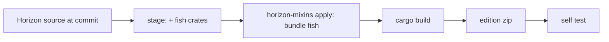

# The Fish Edition

Fish does not patch the official Horizon executable (thin LTO, one codegen unit, private symbols, several
Nightlies a day make that fragile). Instead CI builds **Horizon from source at a pinned commit** with Fish's
hooks injected at build time by [horizon-mixins](https://github.com/horizon-rust/horizon-mixins), Horizon's own
compile-time source-mixin tool. The result is the *Fish Edition*: a normal `horizon-client` that loads Fish mods.
Players compile nothing.

## What is injected

| Where | Hook | Fish side |
| --- | --- | --- |
| `horizon_client::spans::enable` (HEAD, called once by `game::run`) | boot | `fish_loader::edition::boot_for_edition` |
| `Game::tick` (HEAD) | tick start | `Dispatch::tick_start` |
| `native_hooks::native_tick` (HEAD) | tick end, after Horizon's own mods | `Dispatch::tick_end` |
| `native_frame`, `native_hud`, `native_key` (HEAD) | frame, HUD, keys | `Dispatch::frame/hud/key` |
| `native_command` (HEAD) | raw client commands | `Dispatch::client_command` |
| `native_mods`, `native_settings`, `native_settings_click` (HEAD) | Options > Mods rows | `Dispatch::list_mods/settings_*` |

The `native_*` functions are Horizon's *stable hook points* (`NATIVE_HOOKS_API`): empty functions the game
calls at fixed places, kept across releases. A support module `fish_bridge` is added to `game.rs`; it
implements the `fish-hooks` view traits over Horizon's `Game` using Horizon's own `native_*` helpers, so
Fish's unsafe code stays in Fish crates (`horizon-client` is `#![forbid(unsafe_code)]`).

horizon-mixins refuses targets with opaque macros, unresolved `cfg`, or `RETURN` over `?`. That is why boot
is hooked at `spans::enable` and not at `game::run` (which contains `log::warn!`): the nearest macro-free callee.

## Crates in the edition

`fish-abi`, `fish-metadata`, `fish-pack`, `fish-hooks`, `fish-loader` are copied into the staged workspace as
`fish/crates/*` (manifests rewritten with concrete workspace values, dev-dependencies dropped) and wired into
`horizon-client` by `horizon/cargo-edits.toml`. Their dependencies (serde, semver, toml, zip, sha2, libloading, …)
are already in Horizon's `Cargo.lock`.

## Edition archive

`dist/fish-edition-<fish>-horizon-<short>-<platform>.zip`: `horizon-client(.exe)`, `fish-edition.json`
(ids, versions, ABI, pinned commit, SHA-256 of the binary and of the mixin bundle), `LICENSE-HORIZON`,
`THIRD_PARTY_NOTICES.md`, `LICENSE-FISH`.

## Self test

`FISH_LOADER_SELFTEST=<report.json>` makes the edition boot, drive 20 synthetic client ticks, a frame, the HUD and a
command through the real dispatcher, write a JSON report and exit before the game starts. CI (and
`cargo xtask edition selftest`) checks that the `hello` example loaded and counted exactly 20 ticks.

## Hook map (events of phase P6)

The bridge fires these; the loader derives the rest (`client_started`, `server_started`, the first `world_load`,
`world_unload`, `reload_end`, `block_break_after`, `block_break_canceled`, `after_damage`, `modify_send`). Where Horizon has no
exact point, the event is **approximated**; the notes say how.

| Event | Hook (HEAD unless noted) | Note |
| --- | --- | --- |
| `client_stopping` | `Game::save_for_exit` | once |
| `client_stopped` | `discord_presence::stop` | detached |
| `server_starting` | `Game::load_world` | not for `--in-frame` worlds |
| `server_stopping` / `server_stopped` | `stop_integrated`, `stop_dedicated` / `lan_close` | stopped is gated by stopping |
| `world_load` (other levels) | `levels::open_level` | idle-level unloads are not reported |
| `chunk_load` / `chunk_unload` | `ChunkMap::insert` / `remove` | detached; dimension is the thread's last known; `clear` not reported |
| `reload_start` | `reload_datapacks` (`/reload` only) | |
| `use_block` / `use_item` / `use_entity` | `Game::use_item` | **approximated**: one of the three per click, classified by what the player aims at; `use_item` is not raised when a block is aimed at. Client predictions: `remote_use_*` |
| `attack_entity` | `Game::attack`, `guest_attack`, `remote_start_attack` | |
| `attack_block` | `Game::attack_block`, `remote_mining` | **approximated**: the server path only covers the punch path |
| `block_break_before` | `break_block_as_player` | veto |
| `pick_item` | `pick_item::pick` | |
| `allow_damage` | `mobs::ai::accepts_damage`, `PlayerMotion::hurt_caused_by` | veto; the player's actor is the last one the game acted for and may be empty |
| `allow_death` | inside the damage hooks when `amount >= health` | **approximated**: raw amount before armor; cancelling rejects the whole damage |
| `after_death` | `mob_died`; players by edge detection on the next tick | the in-frame local player's death is **not reported** |
| `player_join` / `player_leave` | `load_guest_records` / `lan_crafting_left` (+ one per player at server stop) | |
| `after_respawn`, `copy_from` | edge detection for guests, `respawn_player` for the local player | fired together |
| `allow_sleeping` | `try_sleep` | veto |
| `sleep_start` / `sleep_stop` | edge detection / `wake_up` | |
| `allow_chat`, `allow_command`, `chat`, `command` | `Hub::try_handle_chat`, `broadcast_chat`, `guest_command` | `command` fires at the allow gate, not after the command ran |
| `allow_game` / `game` | `Hub::system_message` | **approximated**: only the broadcast message; per-player system messages are not covered |
| `allow_receive` / `receive` | `remote::chat_line`, `chat::local_chat_line` | `receive` fires just before the line is added |
| `allow_send`, `modify_send`, `send` | `chat::handle_chat_input`, `remote::send_chat` | rewrites re-enter the handler behind a guard |
| commands | `commands::run_command` | the root is checked against vanilla's dispatcher; chat tab-completion of Fish commands is not wired |
| F3 lines | RETURN `debug_overlay::Displayer::columns` | right column |
| crash details | `crash::set_detail` from boot, every 100 ticks and at server stop | extra lines in **System Details**, not a separate section |
| game rules in the command tree | RETURN `horizon_command::vanilla::build_with` | the Fish rules become literals under `gamerule` (a boolean or number argument, or one literal per enum choice); the tree is built on first use, after Fish booted; `horizon-command` gets `fish-hooks` as a dependency |
| `/gamerule` of a Fish rule | cancellable HEAD `Game::cmd_gamerule` | queries and sets through `Dispatch::game_rule_*` in the world's folder; also serves LAN guests' commands; vanilla rules and unknown names fall through |
| game rules read | HEAD `Game::load_world_state` | `Dispatch::game_rules_load` reads `data/fish/game_rules.json` |
| game rules saved | HEAD `Game::save_game_metadata` | `Dispatch::game_rules_save`; `save_world_state` has an opaque macro, its caller does not |
| the world of a game | `ClientView::world_id` (the bundle's views) | the folder of `world_root`, `None` without one (remote server); the loader makes it the thread's world while an event runs, which is what a mod's `get`/`set` act on |
| Game Rules screen | **patch** `0005-gamerule-screen.patch` | `RulesScreen::with_fish` adds the rows of the in-world screen; its state is private, so no hook can |
| `use` (blocks of Fish) | extends the `Game::use_item` hook | blocks of Fish get `on_use` through `Dispatch::block_event` before the generic `use_block` event; `Handled` or `Cancel` ends the click |
| `place` (blocks of Fish) | HEAD `Game::apply_item_block_state` | `Dispatch::block_event` with `Place` for blocks whose state lies in a Fish run; the call sits in the code that places a block item, a player's or a dispenser's |
| `broken` (blocks of Fish) | HEAD `Game::break_block_as_player`, then the tick's end | **approximated**: a break that no listener vetoed is noted, and `Broken` fires at the end of the tick when the block is gone (a refused break reports nothing) |
| `neighbor_changed`, `random_tick`, `scheduled_tick` | **patch** `0007-block-ticks.patch` on horizon-world `Sim` | the block simulation reports them to `Dispatch::block_event`; they fire for any Fish block whose template runs them |
| content overlay | **patch** `0006-content-mods.patch` on `game/mods.rs::content_root` | adds the Fish content folders (`<game dir>/.fish/content/<mod_id>/`) as always-on content mods; the loader writes them via `Dispatch::block_content` |

A derived event whose own listeners are missing still raises its base event when a derived listener exists (a mod that
listens only to `modify_send` still gets called).
