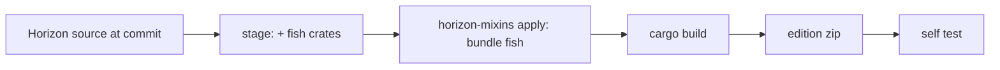

# The Fish Edition

Fish does not patch the official Horizon executable (thin LTO, one codegen unit, private symbols, several
Nightlies a day make that fragile). Instead CI builds **Horizon from source at a pinned commit** with Fish's
hooks injected at build time by [horizon-mixins](https://github.com/horizon-rust/horizon-mixins), Horizon's own
compile-time source-mixin tool. The result is the *Fish Edition*: a normal `horizon-client` that loads Fish mods.
Players compile nothing.

## What is injected

| Where | Hook | Fish side |
| --- | --- | --- |
| `horizon_client::spans::enable` (HEAD, called once by `game::run`) | boot | `fish_loader::edition::boot_for_edition` |
| `Game::tick` (HEAD) | tick start | `Dispatch::tick_start` |
| `native_hooks::native_tick` (HEAD) | tick end, after Horizon's own mods | `Dispatch::tick_end` |
| `native_frame`, `native_hud`, `native_key` (HEAD) | frame, HUD, keys | `Dispatch::frame/hud/key` |
| `native_command` (HEAD) | raw client commands | `Dispatch::client_command` |
| `native_mods`, `native_settings`, `native_settings_click` (HEAD) | Options > Mods rows | `Dispatch::list_mods/settings_*` |

The `native_*` functions are Horizon's *stable hook points* (`NATIVE_HOOKS_API`): empty functions the game
calls at fixed places, kept across releases. A support module `fish_bridge` is added to `game.rs`; it
implements the `fish-hooks` view traits over Horizon's `Game` using Horizon's own `native_*` helpers, so
Fish's unsafe code stays in Fish crates (`horizon-client` is `#![forbid(unsafe_code)]`).

horizon-mixins refuses targets with opaque macros, unresolved `cfg`, or `RETURN` over `?`. That is why boot
is hooked at `spans::enable` and not at `game::run` (which contains `log::warn!`): the nearest macro-free callee.

## Crates in the edition

`fish-abi`, `fish-metadata`, `fish-pack`, `fish-hooks`, `fish-loader` are copied into the staged workspace as
`fish/crates/*` (manifests rewritten with concrete workspace values, dev-dependencies dropped) and wired into
`horizon-client` by `horizon/cargo-edits.toml`. Their dependencies (serde, semver, toml, zip, sha2, libloading, …)
are already in Horizon's `Cargo.lock`.

## Edition archive

`dist/fish-edition-<fish>-horizon-<short>-<platform>.zip`: `horizon-client(.exe)`, `fish-edition.json`
(ids, versions, ABI, pinned commit, SHA-256 of the binary and of the mixin bundle), `LICENSE-HORIZON`,
`THIRD_PARTY_NOTICES.md`, `LICENSE-FISH`.

## Self test

`FISH_LOADER_SELFTEST=<report.json>` makes the edition boot, drive 20 synthetic client ticks, a frame, the HUD and a
command through the real dispatcher, write a JSON report and exit before the game starts. CI (and
`cargo xtask edition selftest`) checks that the `hello` example loaded and counted exactly 20 ticks.
