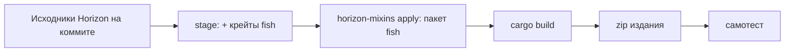

# Fish Edition

Fish не патчит официальный исполняемый файл Horizon (thin LTO, один codegen unit, приватные символы и
несколько Nightly в день делают это хрупким). Вместо этого CI собирает **Horizon из исходников на
зафиксированном коммите**, внедряя хуки Fish на этапе сборки через
[horizon-mixins](https://github.com/horizon-rust/horizon-mixins) — собственный инструмент Horizon для
миксинов исходников. Результат — *Fish Edition*: обычный `horizon-client`, загружающий моды Fish.
Игрокам ничего не нужно компилировать.

## Что внедряется

| Где | Хук | Сторона Fish |
| --- | --- | --- |
| `horizon_client::spans::enable` (HEAD, вызывается один раз из `game::run`) | запуск | `fish_loader::edition::boot_for_edition` |
| `Game::tick` (HEAD) | начало тика | `Dispatch::tick_start` |
| `native_hooks::native_tick` (HEAD) | конец тика, после собственных модов Horizon | `Dispatch::tick_end` |
| `native_frame`, `native_hud`, `native_key` (HEAD) | кадр, HUD, клавиши | `Dispatch::frame/hud/key` |
| `native_command` (HEAD) | сырые клиентские команды | `Dispatch::client_command` |
| `native_mods`, `native_settings`, `native_settings_click` (HEAD) | строки Options > Mods | `Dispatch::list_mods/settings_*` |

Функции `native_*` — *стабильные точки хуков* Horizon (`NATIVE_HOOKS_API`): пустые функции, которые игра
вызывает в фиксированных местах и сохраняет между релизами. В `game.rs` добавляется вспомогательный модуль
`fish_bridge`; он реализует трейты представлений `fish-hooks` поверх `Game` через собственные помощники
`native_*` Horizon, так что `unsafe`-код Fish остаётся в крейтах Fish (`horizon-client` — `#![forbid(unsafe_code)]`).

horizon-mixins отклоняет цели с непрозрачными макросами, неразрешённым `cfg` или `RETURN` поверх `?`. Поэтому
запуск повешен на `spans::enable`, а не на `game::run` (там есть `log::warn!`): это ближайшая функция без макросов.

## Крейты в издании

`fish-abi`, `fish-metadata`, `fish-pack`, `fish-hooks`, `fish-loader` копируются в подготовленный workspace как
`fish/crates/*` (манифесты переписаны с конкретными значениями workspace, dev-зависимости убраны) и подключаются к
`horizon-client` через `horizon/cargo-edits.toml`. Их зависимости (serde, semver, toml, zip, sha2, libloading, …)
уже есть в `Cargo.lock` Horizon.

## Архив издания

`dist/fish-edition-<fish>-horizon-<short>-<platform>.zip`: `horizon-client(.exe)`, `fish-edition.json`
(идентификаторы, версии, ABI, закреплённый коммит, SHA-256 бинарника и пакета миксинов), `LICENSE-HORIZON`,
`THIRD_PARTY_NOTICES.md`, `LICENSE-FISH`.

## Самотест

`FISH_LOADER_SELFTEST=<report.json>` заставляет издание загрузиться, прогнать 20 синтетических клиентских тиков,
кадр, HUD и команду через настоящий диспетчер, записать JSON-отчёт и выйти до старта игры. CI (и
`cargo xtask edition selftest`) проверяет, что пример `hello` загрузился и насчитал ровно 20 тиков.

## Карта хуков (события фазы P6)

Мост шлёт эти события; остальные выводит загрузчик (`client_started`, `server_started`, первый `world_load`,
`world_unload`, `reload_end`, `block_break_after`, `block_break_canceled`, `after_damage`, `modify_send`). Если в Horizon нет точной
точки, событие **приближено**; примечания говорят как.

| Событие | Хук (HEAD, если не сказано иное) | Примечание |
| --- | --- | --- |
| `client_stopping` | `Game::save_for_exit` | один раз |
| `client_stopped` | `discord_presence::stop` | без вида игры |
| `server_starting` | `Game::load_world` | не для миров `--in-frame` |
| `server_stopping` / `server_stopped` | `stop_integrated`, `stop_dedicated` / `lan_close` | stopped включается после stopping |
| `world_load` (другие уровни) | `levels::open_level` | выгрузка простаивающих уровней не сообщается |
| `chunk_load` / `chunk_unload` | `ChunkMap::insert` / `remove` | без вида игры; измерение — последнее известное потоку; `clear` не сообщается |
| `reload_start` | `reload_datapacks` (только `/reload`) | |
| `use_block` / `use_item` / `use_entity` | `Game::use_item` | **приближено**: одно из трёх на клик по тому, куда целится игрок; `use_item` не приходит, если целится в блок. Предсказания клиента: `remote_use_*` |
| `attack_entity` | `Game::attack`, `guest_attack`, `remote_start_attack` | |
| `attack_block` | `Game::attack_block`, `remote_mining` | **приближено**: серверный путь покрывает только удар по блоку |
| `block_break_before` | `break_block_as_player` | запрет |
| `pick_item` | `pick_item::pick` | |
| `allow_damage` | `mobs::ai::accepts_damage`, `PlayerMotion::hurt_caused_by` | запрет; «актёр» игрока — последний, для кого действовала игра, может быть пустым |
| `allow_death` | внутри хуков урона при `amount >= health` | **приближено**: сырой урон до брони; отмена отвергает весь урон |
| `after_death` | `mob_died`; игроки — по смене состояния на следующем тике | смерть локального игрока in-frame **не сообщается** |
| `player_join` / `player_leave` | `load_guest_records` / `lan_crafting_left` (+ по одному на игрока при остановке сервера) | |
| `after_respawn`, `copy_from` | смена состояния для гостей, `respawn_player` для локального игрока | приходят вместе |
| `allow_sleeping` | `try_sleep` | запрет |
| `sleep_start` / `sleep_stop` | смена состояния / `wake_up` | |
| `allow_chat`, `allow_command`, `chat`, `command` | `Hub::try_handle_chat`, `broadcast_chat`, `guest_command` | `command` приходит на этапе проверки, а не после выполнения |
| `allow_game` / `game` | `Hub::system_message` | **приближено**: только общее сообщение; персональные системные сообщения не покрыты |
| `allow_receive` / `receive` | `remote::chat_line`, `chat::local_chat_line` | `receive` приходит перед добавлением строки |
| `allow_send`, `modify_send`, `send` | `chat::handle_chat_input`, `remote::send_chat` | переписанная строка входит в обработчик заново под защитой от рекурсии |
| команды | `commands::run_command` | корень сверяется с диспетчером ванили; автодополнение Fish-команд в чате не подключено |
| строки F3 | RETURN `debug_overlay::Displayer::columns` | правая колонка |
| данные о падении | `crash::set_detail` при загрузке, каждые 100 тиков и при остановке сервера | дополнительные строки в **System Details**, а не отдельный раздел |
| игровые правила в дереве команд | RETURN `horizon_command::vanilla::build_with` | правила Fish становятся литералами под `gamerule` (аргумент-логическое или число, либо литерал на каждый вариант enum); дерево строится при первом использовании, после загрузки Fish; `horizon-command` получает зависимость `fish-hooks` |
| `/gamerule` правила Fish | отменяемый HEAD `Game::cmd_gamerule` | читает и пишет через `Dispatch::game_rule_*` в папке мира; обслуживает и команды гостей LAN; правила игры и неизвестные имена проходят дальше |
| чтение игровых правил | HEAD `Game::load_world_state` | `Dispatch::game_rules_load` читает `data/fish/game_rules.json` |
| сохранение игровых правил | HEAD `Game::save_game_metadata` | `Dispatch::game_rules_save`; в `save_world_state` есть непрозрачный макрос, в вызывающей функции нет |
| мир игры | `ClientView::world_id` (виды моста) | папка `world_root`, `None` без неё (удалённый сервер); загрузчик делает её миром потока на время события, на нём работают `get`/`set` мода |
| экран «Игровые правила» | **патч** `0005-gamerule-screen.patch` | `RulesScreen::with_fish` добавляет строки экрана открытого мира; его состояние приватно, хук не справится |
| `use` (блоки Fish) | расширяет хук `Game::use_item` | блоки Fish получают `on_use` через `Dispatch::block_event` раньше общего события `use_block`; `Handled` или `Cancel` завершает клик |
| `place` (блоки Fish) | HEAD `Game::apply_item_block_state` | `Dispatch::block_event` с `Place` для блоков, состояние которых лежит в диапазоне Fish; вызов стоит в коде, который ставит блок-предмет игрока или раздатчика |
| `broken` (блоки Fish) | HEAD `Game::break_block_as_player`, затем конец тика | **приблизительно**: запоминается разрушение, которое не отменил ни один слушатель, а `Broken` срабатывает в конце тика, когда блока уже нет (отказ игры не сообщается) |
| `neighbor_changed`, `random_tick`, `scheduled_tick` | **патч** `0007-block-ticks.patch` к horizon-world `Sim` | симуляция блоков сообщает о них в `Dispatch::block_event`; срабатывают для любого блока Fish, чей шаблон их выполняет |
| оверлей контента | **патч** `0006-content-mods.patch` к `game/mods.rs::content_root` | добавляет папки контента Fish (`<папка игры>/.fish/content/<id_мода>/`) как всегда включённые контент-моды; загрузчик пишет их через `Dispatch::block_content` |

Выводимое событие без собственных слушателей всё равно поднимает базовое событие, если есть слушатель выводимого (мод,
слушающий только `modify_send`, всё равно будет вызван).
