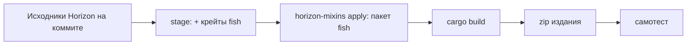

# Fish Edition

Fish не патчит официальный исполняемый файл Horizon (thin LTO, один codegen unit, приватные символы и
несколько Nightly в день делают это хрупким). Вместо этого CI собирает **Horizon из исходников на
зафиксированном коммите**, внедряя хуки Fish на этапе сборки через
[horizon-mixins](https://github.com/horizon-rust/horizon-mixins) — собственный инструмент Horizon для
миксинов исходников. Результат — *Fish Edition*: обычный `horizon-client`, загружающий моды Fish.
Игрокам ничего не нужно компилировать.

## Что внедряется

| Где | Хук | Сторона Fish |
| --- | --- | --- |
| `horizon_client::spans::enable` (HEAD, вызывается один раз из `game::run`) | запуск | `fish_loader::edition::boot_for_edition` |
| `Game::tick` (HEAD) | начало тика | `Dispatch::tick_start` |
| `native_hooks::native_tick` (HEAD) | конец тика, после собственных модов Horizon | `Dispatch::tick_end` |
| `native_frame`, `native_hud`, `native_key` (HEAD) | кадр, HUD, клавиши | `Dispatch::frame/hud/key` |
| `native_command` (HEAD) | сырые клиентские команды | `Dispatch::client_command` |
| `native_mods`, `native_settings`, `native_settings_click` (HEAD) | строки Options > Mods | `Dispatch::list_mods/settings_*` |

Функции `native_*` — *стабильные точки хуков* Horizon (`NATIVE_HOOKS_API`): пустые функции, которые игра
вызывает в фиксированных местах и сохраняет между релизами. В `game.rs` добавляется вспомогательный модуль
`fish_bridge`; он реализует трейты представлений `fish-hooks` поверх `Game` через собственные помощники
`native_*` Horizon, так что `unsafe`-код Fish остаётся в крейтах Fish (`horizon-client` — `#![forbid(unsafe_code)]`).

horizon-mixins отклоняет цели с непрозрачными макросами, неразрешённым `cfg` или `RETURN` поверх `?`. Поэтому
запуск повешен на `spans::enable`, а не на `game::run` (там есть `log::warn!`): это ближайшая функция без макросов.

## Крейты в издании

`fish-abi`, `fish-metadata`, `fish-pack`, `fish-hooks`, `fish-loader` копируются в подготовленный workspace как
`fish/crates/*` (манифесты переписаны с конкретными значениями workspace, dev-зависимости убраны) и подключаются к
`horizon-client` через `horizon/cargo-edits.toml`. Их зависимости (serde, semver, toml, zip, sha2, libloading, …)
уже есть в `Cargo.lock` Horizon.

## Архив издания

`dist/fish-edition-<fish>-horizon-<short>-<platform>.zip`: `horizon-client(.exe)`, `fish-edition.json`
(идентификаторы, версии, ABI, закреплённый коммит, SHA-256 бинарника и пакета миксинов), `LICENSE-HORIZON`,
`THIRD_PARTY_NOTICES.md`, `LICENSE-FISH`.

## Самотест

`FISH_LOADER_SELFTEST=<report.json>` заставляет издание загрузиться, прогнать 20 синтетических клиентских тиков,
кадр, HUD и команду через настоящий диспетчер, записать JSON-отчёт и выйти до старта игры. CI (и
`cargo xtask edition selftest`) проверяет, что пример `hello` загрузился и насчитал ровно 20 тиков.
